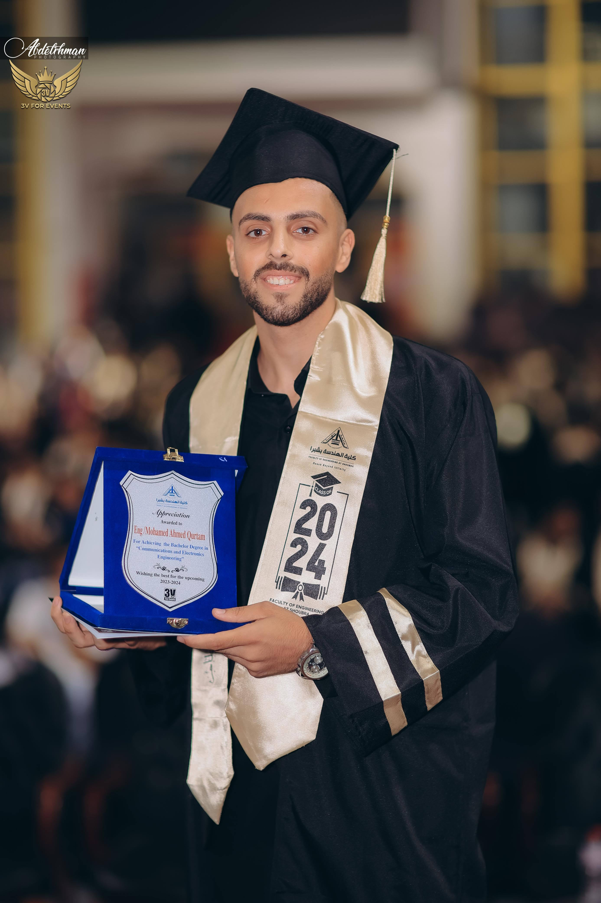

<!-- ============================================================
  Edit.md — Mohamed Qurtam | Network & Security Engineer
  Layout modelled on mmaklad.online:
  hero (photo + intro) → About → Experience → Skills → Education
  → Projects → Certifications → Contact

  PART 1 = copy-ready profile      PART 2 = notes (delete before publishing)
  Keep the folder structure:  Edit.md  +  images/photo-arch.png
============================================================ -->

<a id="top"></a>

<div align="center">

**[About](#about)** · **[Experience](#experience)** · **[Skills](#skills)** · **[Education](#education)** · **[Projects](#projects)** · **[Certifications](#certifications)** · **[Contact](#contact)**

</div>

---

<!-- ============ HERO (photo in the first section) ============ -->

<table>
<tr>
<td valign="middle" width="60%">

`● OPEN TO NEW OPPORTUNITIES`

# Mohamed Qurtam

**NETWORK & SECURITY ENGINEER** `|`

*Securing networks. Engineering resilient infrastructure.*

Working at the intersection of network infrastructure and defensive security. Designing, deploying and securing enterprise infrastructure across the MENA region at **Co-brand Solution**.

**[⬇ Download CV](Mohamed_Qurtam-Security_Engineer-CV.pdf)** · **[View Projects](#projects)**

[Email](mailto:moqurtam@gmail.com) · [LinkedIn](https://linkedin.com/in/mohamed-qurtam) · [GitHub](https://github.com/Mohamed-Qurtam)

</td>
<td valign="middle" align="center" width="40%">



<sub>Benha University · Class of 2024</sub>

</td>
</tr>
</table>

<div align="center">

`Palo Alto` · `FortiGate` · `Splunk` · `Wireshark` · `Nmap` · `IDS/IPS` · `CCNA` · `Linux` · `AWS` · `Python` · `Bash`

</div>

---

## About

`// 01 · WHO I AM`

### Networks. Security. Clear communication.

I'm a **Network & Security Engineer** and Communication & Electronics Engineering graduate (Excellent with Honors) with hands-on experience in switches, routers, firewall configuration, SIEM monitoring and incident response. Beyond engineering, my work in cybersecurity content, technical session coordination and programming education shapes how I communicate complex ideas.

**WHAT I DO**

| | |
|---|---|
| **01 · Network Engineering** | Design and deploy campus switching, routing, Wi-Fi and SD-WAN with predictable performance and controlled growth. |
| **02 · Firewall & Defensive Security** | Configure Palo Alto and FortiGate policies, segmentation and IDS/IPS to protect enterprise networks in layers. |
| **03 · Monitoring & Response** | Use SIEM monitoring, log analysis and incident-response playbooks to detect, investigate and contain threats. |

**AT A GLANCE**

| 11 | 20+ | 100+ | 2024 |
|:---:|:---:|:---:|:---:|
| Certificates | Cybersecurity modules created | Technical sessions managed | B.Sc. graduate, Honors |

**Strengths:** Analytical thinking · Clear documentation · Knowledge sharing
**Languages:** Arabic (Native) · English (Very Good)

[↑ Back to top](#top)

---

## Experience

`// 02 · CAREER`

### 🟢 Network & Security Engineer: Co-brand Solution
`Sep 2026 – Present`

Design, deploy and secure enterprise network and security infrastructure for clients across the MENA region, including firewalls, switching, Wi-Fi and SD-WAN. Monitor and troubleshoot to meet SLAs, run security hardening and vulnerability assessments, and document solutions for client handover.

`Firewalls` `Switching` `Wi-Fi` `SD-WAN` `Hardening` `Vulnerability Assessment`

### Programming Tutor (DEMI): iSchool
`2026`

Delivered programming lessons, guided students through coding projects and problem-solving activities, and helped them build logical thinking and fundamental programming skills.

`Python` `Problem Solving` `Teaching`

### IT Specialist: Information Systems Department, Egyptian Military Academy
`2025 – 2026`

Performed maintenance and repairs for computers, monitors and printers. Managed account administration and installed firmware, updates and system images for PCs.

`Account Administration` `Imaging` `Hardware Support`

### Content Creator, Cybersecurity Track: Armstrong
`2024`

Created 20+ educational modules simplifying cybersecurity concepts and boosted learner engagement through structured content.

`Cybersecurity` `Technical Writing`

### Session Coordinator: Almentor
`2023 – 2025`

Managed 100+ technical sessions with high participant satisfaction and reduced session issues through refined coordination workflows.

`Coordination` `Workflow Improvement`

[↑ Back to top](#top)

---

## Skills

`// 03 · CAPABILITIES`

Core competencies spanning enterprise firewalls, defensive SOC operations, cloud security and scripting.

| Area | Tools & topics |
|---|---|
| **Network & firewall engineering** | `Palo Alto` `FortiGate` `IDS/IPS` `Firewall policies` `Network segmentation` `Traffic analysis` `CCNA routing & switching` |
| **Blue Team & SOC** | `Incident response` `Threat detection` `Log analysis` `Security monitoring` `SOC metrics` `Playbooks` `Malware analysis` `Digital forensics` |
| **Network & security tools** | `Splunk (SIEM)` `Wireshark` `Nmap` `Metasploit` |
| **Systems & cloud** | `Linux` `Windows` `AWS architecture` `AWS core services` `Cloud security basics` |
| **Programming** | `Python` `Bash` `C/C++` `HTML` `CSS` `JavaScript` `Backend concepts` |

[↑ Back to top](#top)

---

## Education

`// 04 · ACADEMIC BACKGROUND`

### B.Sc. Communication & Electronics Engineering
**Benha University · Faculty of Engineering at Shoubra · June 2024**
`Excellent with Honors`

An engineering foundation in communication, electronics and technical problem-solving.

[↑ Back to top](#top)

---

## Projects

`// 05 · ENGINEERING PORTFOLIO`

### Network Security Architecture (Graduation Project)

A secure network built with Palo Alto firewalls, designed for scalability, performance and layered protection.

```text
              WAN / INTERNET
                    │
          ┌─────────────────────┐
          │   PALO ALTO NGFW    │   Virtual routers · Policies
          └─────────────────────┘
        ┌───────────┼───────────┐
   TRUST ZONE    DMZ ZONE    UNTRUST ZONE
   Internal LAN  Public-facing  External traffic

   Security policies layer:  NAT · App-ID rules · QoS · DoS protection
```
<sub>Illustrative diagram based on graduation project scope.</sub>

- **Zone-based segmentation:** virtual routers and multiple security zones establish the network architecture.
- **Application-aware policies:** NAT policies and application-based security rules control network traffic.
- **Performance & protection:** QoS policies and DoS protection support a secure, scalable network.

**[Read the project book ↗](YOUR-PROJECT-BOOK-LINK)**

### Beyond the Firewall

| **DEV · Python & Web Development** | **SYS · Networks & Embedded Systems** |
|---|---|
| Signal analysis, game development and web applications using HTML, CSS, JavaScript and backend concepts.<br>`Python` `HTML/CSS` `JavaScript` `Backend` | Technical projects involving networking, embedded systems and automation.<br>`Networking` `Embedded` `Automation` `C/C++` |

[↑ Back to top](#top)

---

## Certifications

`// 06 · CREDENTIALS`

Professional certificates and specialized training across network engineering, security operations, cloud and systems.

- ✅ Deploying Security Strategies for the Modern Network
- ✅ RCNA Routing & Switching
- ✅ Sales Specialist: Kaspersky Next Optimum (S47.2)
- ✅ Blue Team Scholarship, CyberTalents
- ✅ SOC Analyst Foundation, SIEM XPERT
- ✅ AWS Academy Cloud Foundations, NTI
- ✅ Red Hat System Administration I (9.0), NTI
- ✅ Python and Django learning guide, Udemy
- ✅ eLearnSecurity Certified Incident Responder (eCIR), Netriders Academy
- ✅ Cisco CyberOps, National Telecommunication Institute (NTI)
- ✅ Introduction to Cybersecurity Bootcamp (Cohort 5), CyberTalents

[↑ Back to top](#top)

---

## Contact

`// 07 · LET'S CONNECT`

### Let's talk.

For professional opportunities and conversations about network and security engineering.

| | |
|---|---|
| ✉️ **Email** | [moqurtam@gmail.com](mailto:moqurtam@gmail.com) |
| 📞 **Phone (primary)** | +20 1024227004 |
| 📞 **Phone (alternate)** | +20 1015220163 |
| 💼 **LinkedIn** | [linkedin.com/in/mohamed-qurtam](https://linkedin.com/in/mohamed-qurtam) |
| 🐙 **GitHub** | [github.com/Mohamed-Qurtam](https://github.com/Mohamed-Qurtam) |
| 📄 **Resume** | [Download CV (PDF)](Mohamed_Qurtam-Security_Engineer-CV.pdf) |

<div align="center">

<sub>© 2026 Mohamed Qurtam · Network & Security Engineer</sub>

[↑ Top](#top)

</div>

---
---

# PART 2 — Notes (delete this part before publishing)

## 1. What was borrowed from mmaklad.online

| Their site | This file |
|---|---|
| Hero: "Open to New Opportunities" badge, name, uppercase role with cursor `\|`, one-line tagline, Download CV + View Projects, social row, photo on the right | Same order, using a two-column table with the photo in the right cell |
| Scrolling skills ticker | A single centered line of tool tags under the hero |
| Numbered section labels ("Who I Am 01") | `// 01 · WHO I AM` style labels above each heading |
| "What I Build" 01/02/03 and stat cards | "What I do" table and an "At a glance" stat row |
| Experience with tech tags per role | Same, using inline code tags |
| Hover-based skill cards, project carousel, contact form | Not possible in Markdown, so these are covered in the upgrade path (section 5) |

## 2. The photo shape

I couldn't see how mmaklad.online styles the photo (my view of the page was text only), so I used an **arch shape** (rounded top, softly rounded bottom), cropped from your screenshot into `images/photo-arch.png`. Two things to do:

1. **Replace it with your original high-resolution photo** (the cropped version is low-resolution because it came from a screenshot). Keep the same file name.
2. **If their shape is different** (circle, blob, hexagon, tilted frame), tell me which and I'll re-cut it. GitHub strips CSS, so the shape must be baked into a transparent PNG, which is exactly what the file is.

## 3. Responsive guidance

- The hero is a 2-column table: GitHub shows it side by side on desktop and squeezes it on phones. For a safer mobile layout, swap the table for `` placed before the intro text, which wraps naturally.
- Keep tables to 2 columns (the stat row is 4 narrow cells, so keep those labels short).
- Use percentage or small fixed widths on images, and keep a clean heading order (`#` → `##` → `###`).
- Dark/light logo or banner: use `<picture>` with `prefers-color-scheme` sources.

## 4. Motion ideas (what works in Markdown)

- **Typing tagline:** a hosted typing-SVG service can mimic their typewriter role line. It depends on a third party, so keep the plain-text line as fallback.
- **Animated banner/diagram:** a short looping animated SVG or GIF of the firewall zone diagram, under about 1 MB, with a static first frame.
- **Cursor `|`:** already in the hero as a static nod to their blinking cursor.
- Everything else (scroll reveals, hover cards, carousel) needs a real webpage.

## 5. Accessibility

- Alt text describes the content (done for the photo). Decorative emoji in the contact table are paired with text labels.
- Aim for 4.5:1 contrast on any custom banners; your site's grey body text is on the dim side, so lighten it.
- Use descriptive link text and avoid flashing animation; keep GIFs optional.

## 6. Upgrade path to a webpage

1. Anchors `#about`, `#experience`, `#skills`, `#education`, `#projects`, `#certifications`, `#contact` already match the nav, so add the same `id`s to your site sections.
2. Minimal CSS: `body { max-width: 72ch; margin: auto; } img { max-width: 100%; height: auto; } section { scroll-margin-top: 4rem; }` plus a `clip-path`/`border-radius: 999px 999px 24px 24px` on the hero photo to match the arch.
3. Minimal JS: one `IntersectionObserver` for fade-up reveals, a blinking-cursor CSS animation (`@keyframes blink`), and a tab/hover filter for projects, all wrapped in `@media (prefers-reduced-motion: no-preference)`.
4. Before launch: Lighthouse accessibility check, meta description, Open Graph image (your photo), phone-width test.
